# Observant Systems: Overnight Sensation

**Team:** Jacey Hu

**Members:** Jacey Hu (ch2296, kakiko1111)

**Project name:** _TBD_

**Acknowledgements:** I used Claude (Anthropic) to help me set up VNC, fix the locale error, troubleshoot the git merge, and edit the English in this write-up.

---

# Part 1

## Part A. Set up your Pi for on-device AI

I created a virtual environment in the Lab 5 folder and installed the requirements with `uv`. Then I exported the YOLO26 nano model to NCNN.

The first export printed a `UnicodeEncodeError` after almost every message, because my shell couldn't print emoji. The export itself still worked. I fixed the locale in `~/.bashrc` as the lab suggests, and after that the output was clean.

**Test on the sample image.** YOLO found 4 people and 1 bus. Inference took about 98 ms on the Pi 5. The person on the far left was only half visible and got a much lower score (0.56) than the others (0.84 to 0.86).

**Test on my own photo.** I took a photo with `snap.py` while holding my Keroro plush. YOLO detected me but not the plush.

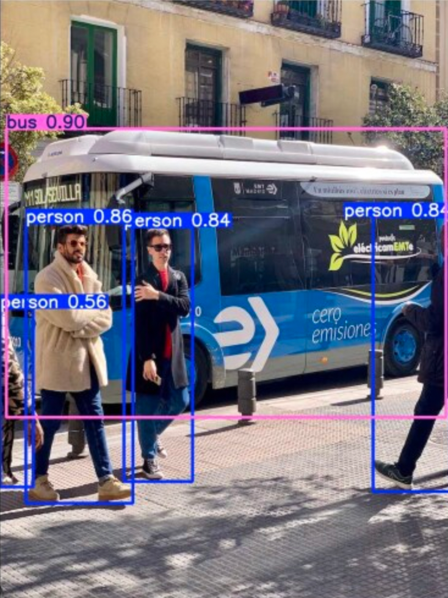 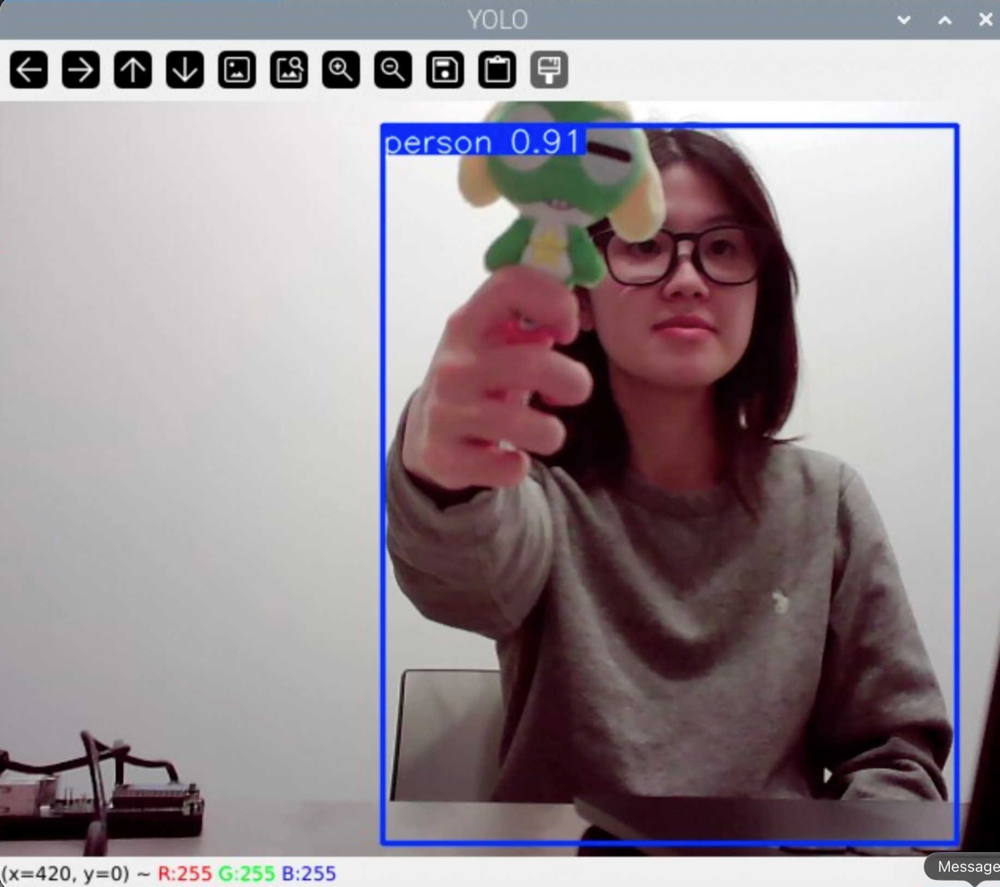

**Ollama and Qwen.** Both models downloaded successfully. Ollama warned that no GPU was found, so it runs on the CPU only.

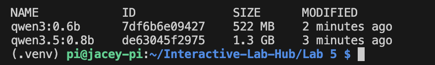

## Part B. See: recognize people in real time with YOLO

I ran `yolo_person.py` through VNC and tried different objects and poses in front of the webcam.

<!-- Add your video link or screenshots here -->

**Three situations where the detector got it wrong**

**1. A photo of a person on my phone was detected as a real person (0.80).**
I held up my phone with a photo of Donald Trump. YOLO drew a person box around the screen with 0.80 confidence. I think this happens because YOLO only looks at shapes and colors in a flat image. It has no depth information, so it can't tell a real person from a picture of one. In a system that counts people in a room, this would add a person who isn't there.

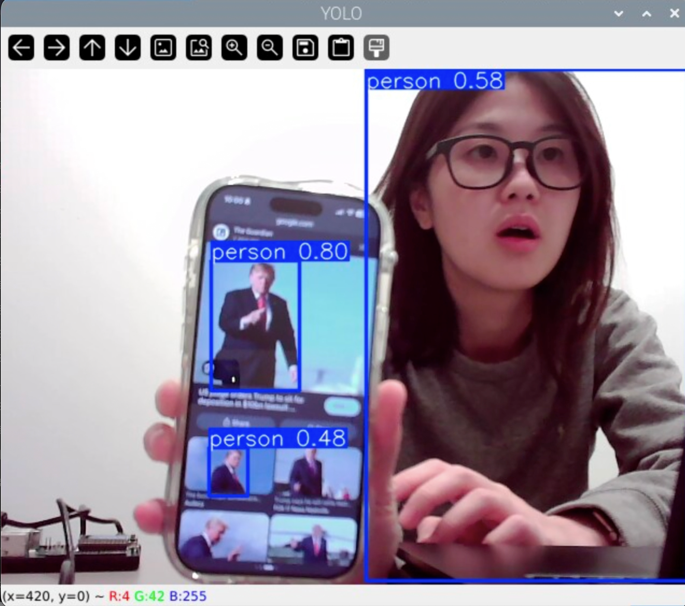

**2. A photo of a teddy bear was labeled as a person (0.51).**
I showed a photo of a teddy bear on my phone. YOLO labeled it "person" with 0.51 confidence. A teddy bear has a head, arms and a body, so its outline looks a bit like a person's. The low score shows the model wasn't sure. A higher confidence threshold (for example `--conf 0.7`) would filter out this kind of mistake, but it might also make the system miss real people.

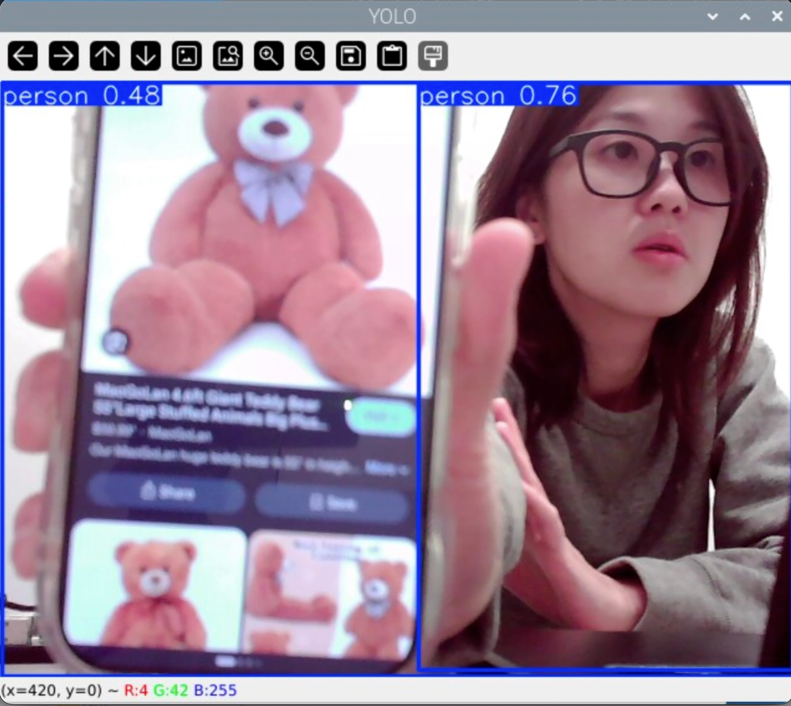

**3. My own confidence dropped when part of my body was hidden.**
With nothing in my hands, YOLO detected me at 0.91. When I held up my phone, my score dropped to 0.58, because my arm and the phone covered part of my face and upper body. When I stretched out my arm to hold the plush and my face went out of the frame, the box only covered half of my body. The model can only judge what it sees, so occlusion and the edges of the frame both make it less sure.

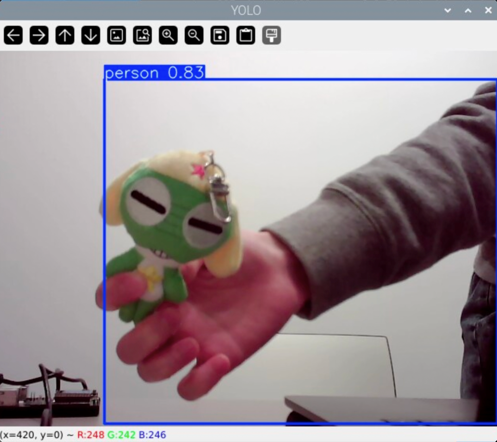

**Other observation:** My Keroro plush was never detected. This is correct, since it's not a person. Even with `--all`, a cartoon frog isn't one of YOLO's 80 classes.

<!-- If you test the flags (--conf 0.2, --conf 0.7, --all, --headless), add what you saw here. -->

## Part C. See more: hands and pose with MediaPipe

<details>
<summary>Instructions</summary>

The demo plays a looping audio file, so make the helper script executable first:

```
chmod +x loop_audio.sh
python hand_pose.py
```

Run it through VNC (it will not work over ssh). Try 1) pinching for percentage control (the thumb-to-index distance sets the volume), and 2) "Quiet Coyote" (the gesture mutes it). A hand is 21 landmark coordinates, and an event is a rule you write over them, the same job as `interpret()` in Part E.

</details>

I ran `hand_pose.py` through VNC with the USB speaker plugged in. The thumb-to-index distance controls the volume.

**What I observed**

**1. Normal use.** With my hand close to the camera, closing my fingers set the volume to 0%, and opening them as wide as I could reached about 60%.

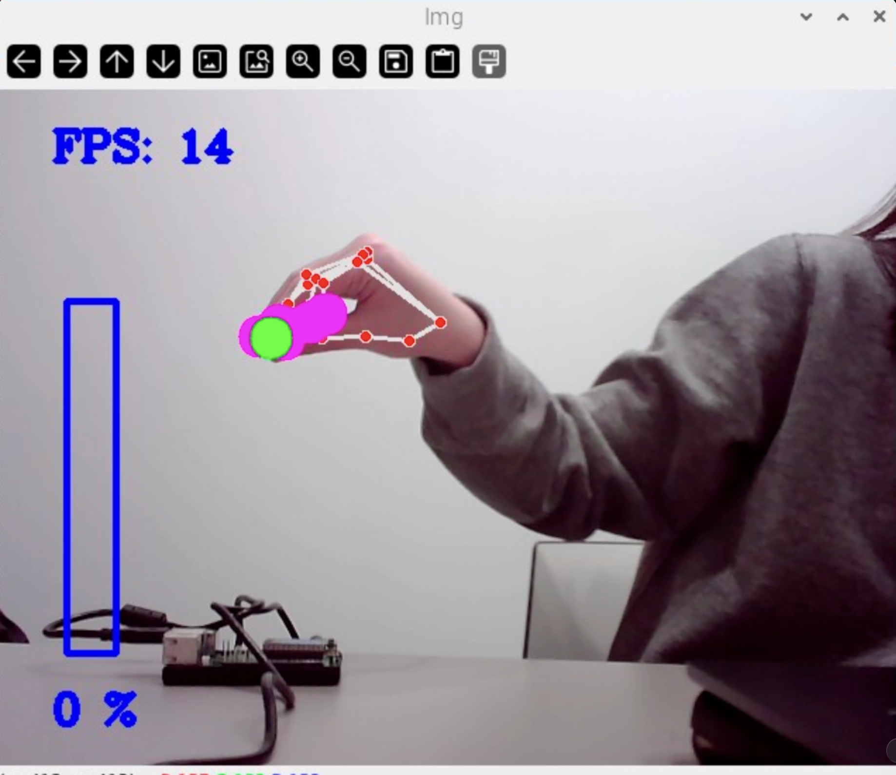 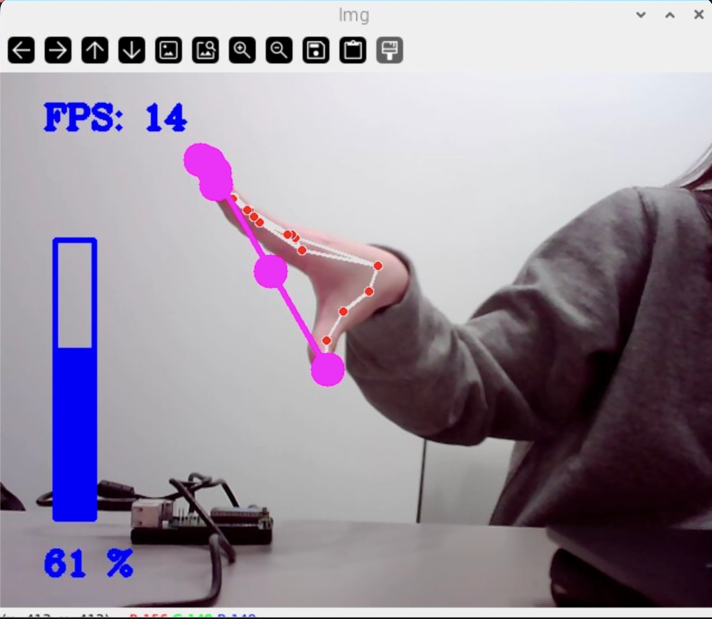

**2. Distance.** The hand was still tracked when it was far from the camera. But even with my fingers fully open, the volume only went up to about 6%. The script measures the distance between the two fingertips in pixels, so a hand that looks smaller on screen gives a smaller number. A better rule would divide the pinch distance by the size of the hand (for example, the wrist-to-palm length), so the same gesture means the same thing at any distance.

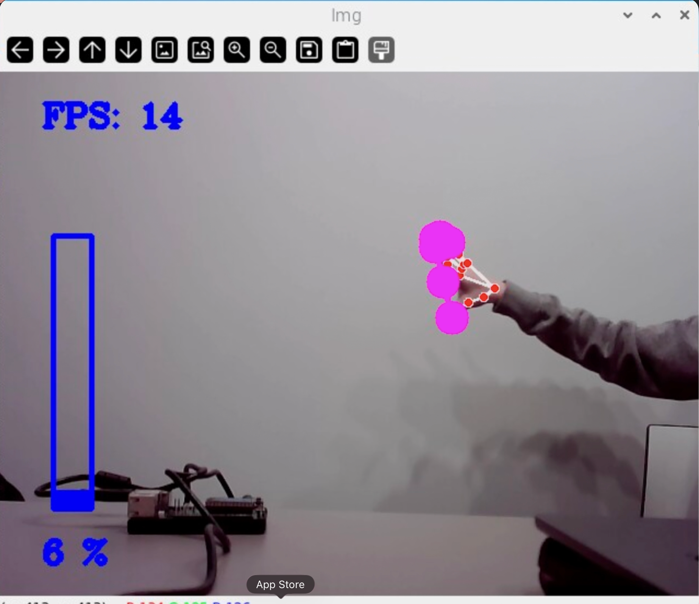

**3. Two hands.** When both hands were in the frame, the control stopped working as expected, and the landmarks jumped to the hand farther from the camera. The script follows only one hand, and it doesn't always pick the one I'm using. In a shared room, this means the device can't tell who is giving the command.

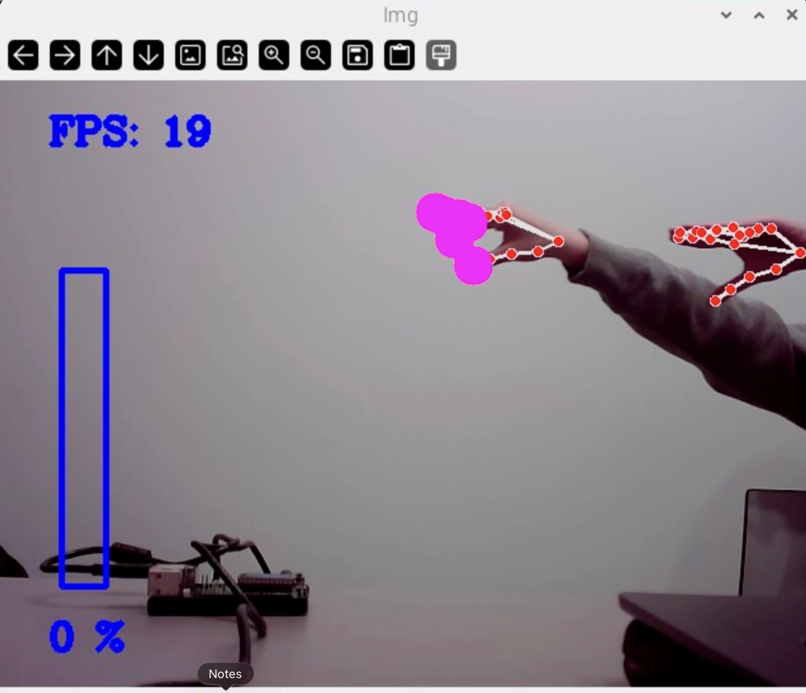

**4. Back of the hand.** With the back of my hand facing the camera, closed fingers still gave 0%, but fully open fingers only reached about 4%. From behind, the thumb and index finger overlap more in the 2D image, so the measured distance is much shorter.

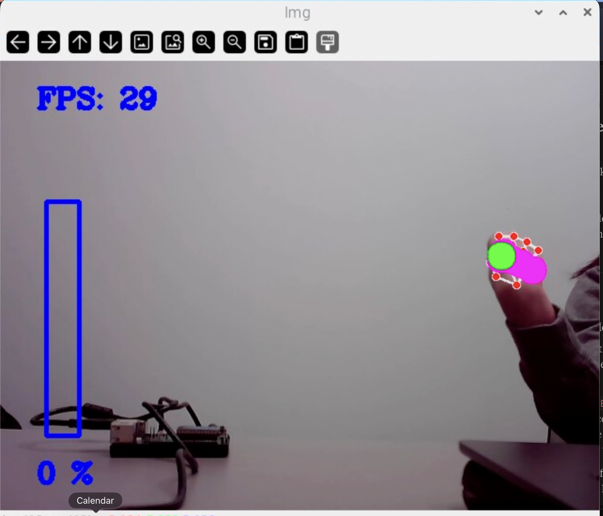 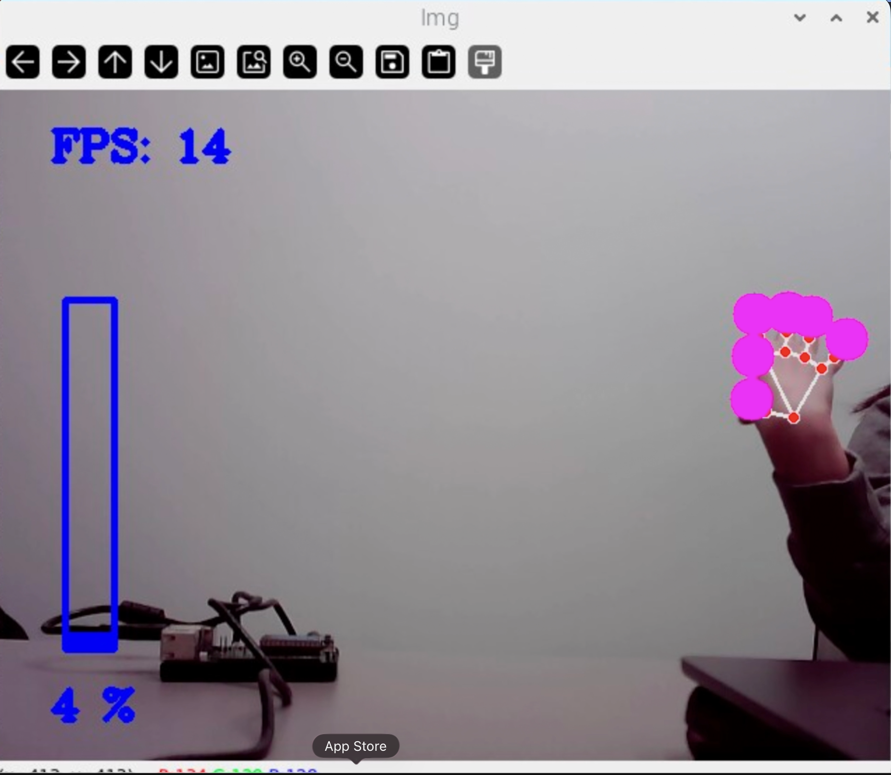

**How I might use pose tracking in my observant system**

Hand gestures are a good fit for the bedtime hand-off in Part 2, because the person can talk to the device without touching anything or speaking in a quiet room. A Quiet Coyote at the camera could mean "start the night shift," and the device could answer by dimming its screen. A pinch could set one number before bed, such as how sensitive the night watch should be.

My tests also showed what I need to design around. The gesture should be made close to the camera with the palm facing it, so I would show a small guide on the screen. If two hands appear, the device should ignore the command and wait, instead of guessing whose hand it is.

## Part D. Reason: run Qwen on the Pi with Ollama

<details>
<summary>Instructions</summary>

```
ollama run qwen3.5:0.8b
>>> /set nothink
>>> Tell me a bit about the history of Roosevelt Island. Three sentences.
>>> /bye
```

Ground truth: it was Blackwell's Island, then Welfare Island, got its current name in 1973, and Cornell Tech opened on it in 2017. Count how many of the model's facts are true.

```
python ask_qwen.py "Tell me a bit about the history of Roosevelt Island."
python ask_qwen.py --model qwen3:0.6b "Tell me a bit about the history of Roosevelt Island."
python ask_qwen.py --image snap.jpg "What is in this photo?"
```

Useful flags: `--think` turns the reasoning trace back on, `--json` asks for a JSON answer, `--image` sends a photo, `--max-tokens` changes the length limit.

</details>

***Ask Qwen three questions to answer. Paste the questions, the answers and how long each took. Try one of them with `qwen3:0.6b` and compare.***

**Question 1: celebrity facts, two models compared**

> When did Taylor Swift get married, and when did she break up with Harry Styles?

**Ground truth:** Taylor Swift married Travis Kelce on July 3, 2026, at Madison Square Garden. She and Harry Styles broke up in early January 2013.

| Model | Answer | Time |
|---|---|---|
| `qwen3.5:0.8b` | "Taylor Swift got married on July 15, 2016, while Harry Styles was still a child. They broke up in March 2024 after a long period of infidelity." | 6.6 s |
| `qwen3:0.6b` | "Taylor Swift got married in 2016, and she broke up with Harry Styles in 2019." | 8.8 s |

Both models got every fact wrong, and both answered with full confidence. The 0.8b model made up a precise date (July 15, 2016) and even a reason for the breakup ("infidelity"). It also said Harry Styles was "still a child" in 2016, but he was in his twenties. The 0.6b model gave shorter, vaguer answers, but they were still wrong. Neither model said "I don't know," even though the wedding probably happened after their training data ends. The smaller model was a bit slower here, probably because it had to load into memory first.

**Question 2: describe a photo**

> What is in this photo? (`--image snap.jpg`, the photo of me holding my Keroro plush from Part A)

| Model | Answer | Time |
|---|---|---|
| `qwen3.5:0.8b` | "A person holding a plush toy of a green turtle-like creature with closed eyes and blonde hair." | 31.9 s |

This answer is partly right. It saw a person holding a green plush toy, which is correct. Keroro is a frog, not a turtle, but "green turtle-like creature" is close. The "blonde hair" is probably Keroro's yellow hat. Looking at an image took about five times longer than a text question.

**Question 3: a wrong premise, thinking on vs. off**

> When did World War III happen?

I asked this in `ollama run qwen3.5:0.8b --verbose`, first with thinking on and then with `/set nothink`.

| Mode | Total time | Tokens generated | Speed |
|---|---|---|---|
| Thinking on | 69.7 s | 390 | 5.6 tokens/s |
| Thinking off | 36.9 s | 208 | 6.0 tokens/s |

With thinking on, the model mostly got it right. It said World War III never happened, but one line contradicted this by saying "World Wars I-III" are in the historical record. With thinking off, it was twice as fast, but the answer fell apart. It said there was no World War III, then said there were "three World Wars historically recorded," gave the Civil War as an example of a "Third World War," and said "the actual conflicts occurred during the Second World War." The speed per token was about the same, so the time saved came only from skipping the reasoning. (The second run also carried the first conversation as context, so this is not a perfectly fair comparison.)

**What I learned**

A 0.8B model sounds confident even when it is completely wrong. It invents dates and details instead of saying it doesn't know, and it can agree with a false premise. In my observant system, I shouldn't ask Qwen for facts it has to remember. I should give it the data (like a night log) and keep its job narrow, so it only summarizes what is actually there.

## Part E. Connect: from YOLO readings to Qwen reasoning

<details>
<summary>Instructions</summary>

`yolo_to_qwen.py` is the whole pipeline: `interpret(r)` turns one YOLO result into a reading in words, `watch(seconds)` logs a reading only when it changes, and `ask(log, question)` sends the log and a question to Qwen. Run it through VNC, or add `--headless` over ssh.

```
python yolo_to_qwen.py
```

It watches for a minute, saves the log to `watch_log.txt`, and asks Qwen the default question.

</details>

I ran `yolo_to_qwen.py` through VNC. During the minute, I walked over to the right side of the room, stayed there for a bit, and walked back.

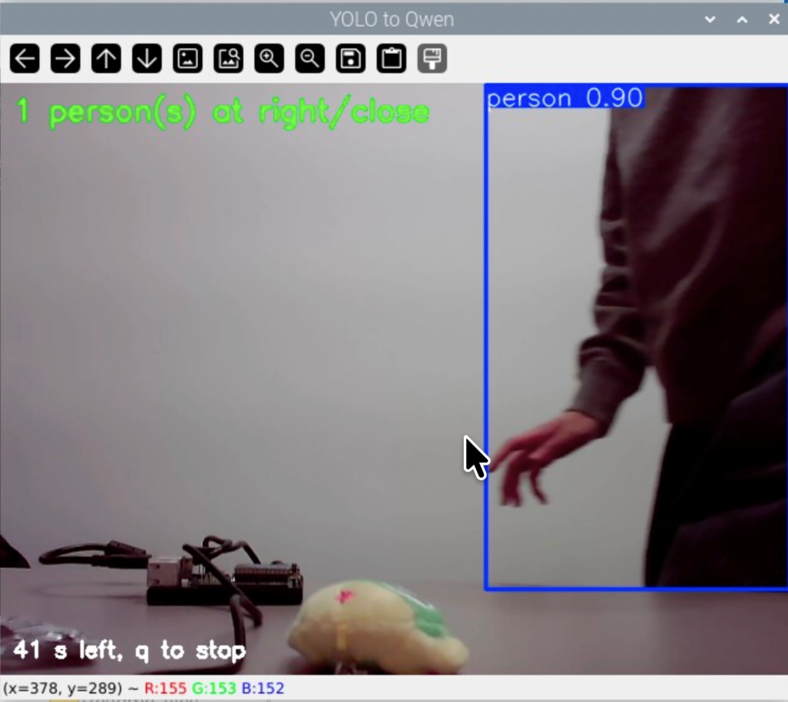

**The log**

```
22:56:46 nobody
22:57:00 1 person(s) at right/close
22:57:01 1 person(s) at center/close
22:57:06 1 person(s) at right/close
22:57:10 1 person(s) at center/close
22:57:11 1 person(s) at left/close
22:57:13 nobody
22:57:19 1 person(s) at left/close
22:57:21 1 person(s) at left/far
22:57:22 nobody
22:57:29 1 person(s) at left/close
22:57:31 1 person(s) at center/close
22:57:31 1 person(s) at right/close
22:57:35 nobody
```

**Qwen's answer (15.0 s)**

> There are 1 person(s) present throughout the entire 60-second period. They were all located within the right or center areas of the room and were consistently moving around between left and center positions. No significant change in activity occurred; everyone remained stationary relative to each other for most of the time, though some individuals moved slightly closer to their respective locations.

**Where the pipeline broke**

*The interpreter.* My movement was simple, but the log has 14 lines. Almost every reading is "close," because the webcam sits near me and my box is usually taller than 60% of the frame, so the close/far rule tells me almost nothing in this setup. Walking across the frame passes through all three thirds in a second or two (two readings at 22:57:31), so one walk becomes several lines. The short "nobody" gaps happen when I step out of the frame or my body is cut off at the edge. The log records every small change, not the event I care about.

*The reasoner.* Qwen's summary doesn't match the log. It says one person was there "throughout the entire 60-second period," but the log shows "nobody" four times. It says the person stayed in the right or center, then says they moved between left and center. It says "no significant change in activity" and "everyone remained stationary," but the log is full of movement. It also talks about "everyone" and "some individuals," even though there was only one person. The model didn't invent new events this time, but it couldn't read a noisy log correctly.

**What I would change**

* Make the interpreter coarser: only log "someone arrived" and "someone left," and ignore gaps shorter than a few seconds.
* Adjust the close/far threshold to fit where the camera actually sits.
* Ask Qwen a narrow question, like "How many times did someone enter?", instead of an open summary. Or count the events in code and only ask Qwen to put the numbers into a sentence.

---

# Part 2: Overnight Sensation

<details>
<summary>Instructions</summary>

Design a night-time interaction. The person meets the device twice: **before bed** (hand the night over) and **when awake** (the device gives something back). In between, the Part E pipeline runs on its own.

* **Sense all night:** the Pi watches, listens or measures and keeps a log.
* **Process all night:** you already have data and the Pi needs hours to get through it.

House rules: sample rather than stream (one look every 5 to 30 seconds), and keep everything on the Pi. Tell the people you live with, point the camera at things rather than at beds, and delete snapshots after the demo.

</details>

## Part F. Storyboard your night-time interaction

***Insert ideas, sketches, Verplank diagrams and storyboards for your night-time interaction here.***

_TBD_

## Prep for Part 2

**Feedback on my ideas:**

_TBD_

***Post your revised storyboard here.***

_TBD_

## Part G. Design the interaction before

***Describe the interaction before.***

_TBD_

## Part H. Incorporate the observant system

<details>
<summary>Instructions</summary>

```
tmux new -s night
python overnight.py
```

Fake a night first (30 seconds of walking around), then run `morning.py`. When that looks right, run a real night. Stop with Ctrl-C in the morning.

</details>

***Screenshots or videos of the running system.***

_TBD_

## Part I. Design the interaction after

<details>
<summary>Instructions</summary>

```
python morning.py
```

Show the report on the Mini PiTFT, read it aloud with Piper, plot a timeline, or use `--json` to move a servo. Make sure it is honest about a night in which nothing happened.

</details>

_TBD_

## Final documentation

***Include a short video of the whole system***

_TBD_