# Distributed Interaction

**Collaborators:**
- Edmond Kong (eck67, edmkong)
- Jacey Hu (ch2296, kakiko1111)
- Gabriela Yaulli (cgy4, cgyh98)

**Demo video:** [Watch Gossiping Pis on Google Drive](https://drive.google.com/file/d/1-fGIk0lGZlaCoq7OVxLD7pXoxYfurYXl/view?usp=sharing)

---

## Part A: MQTT Messaging

We tested publishing and subscribing on the class broker (`farlab.infosci.cornell.edu:1883`) and used `IDD/mamaya` as our team's topic space, for example:

```bash
mosquitto_pub -h farlab.infosci.cornell.edu -p 1883 -t 'IDD/mamaya/edm' -m 'Hello!' -u idd -P 'device@theFarm'
```

**💡 Brainstorm 5 ideas for messaging between devices**

1. **Remote "thinking of you" button**: One Pi publishes `1` on `IDD/mamaya/<name>/nudge` when its button is pressed, and a friend's Pi lights up.
2. **Shared room-occupancy board**: Each Pi uses its proximity sensor to publish `occupied`/`empty` on `IDD/mamaya/<room>/presence`. A display Pi subscribes to `IDD/mamaya/+/presence` and shows which study rooms or desks are free.
3. **Plant care network**: A Pi next to a plant publishes light levels on `IDD/mamaya/plant/light`. When the light stays low for too long, another Pi elsewhere in the house shows "move me to the window!"
4. **Distributed rock-paper-scissors**: Two players have their Pi read a gesture and publish it on `IDD/mamaya/game/<player>`. A third Pi collects the moves and publishes the winner on `IDD/mamaya/game/result`.
5. **Ambient mood lamp**: Every Pi publishes the color it senses on `IDD/mamaya/<name>/color`. A lamp Pi averages all the colors and shows the blend, so the lamp reflects what everyone on the team is seeing.

---

## Part B: Collaborative Pixel Grid

Each Pi reads color from an APDS-9960 sensor and publishes it over MQTT, and a server shows every Pi as one pixel in a shared grid in the browser (`Pi (sensor) → MQTT → Server → Web Browser`).

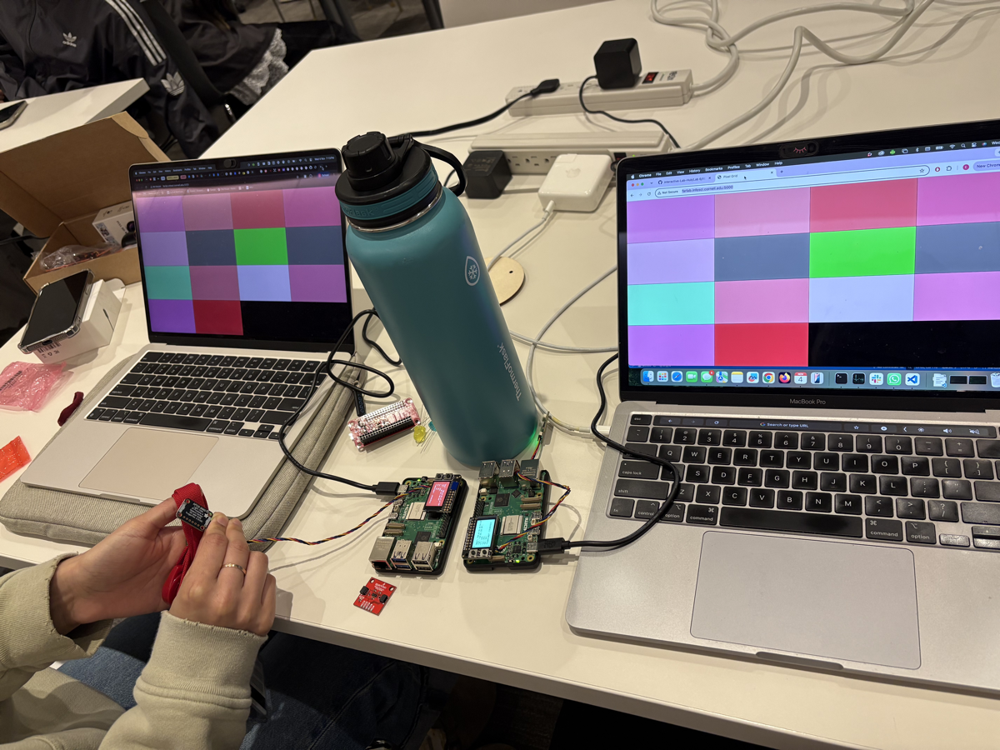

Two Pis with APDS-9960 sensors publish their colors to the shared grid. The same grid is open on both laptops. We cannot remove the other tiles in the grid, but we pointed our sensors to unique colors. One is pointed to a brown box, and another is pointed to a blue bottle.

---

## Part C: Gossiping Pis

Three Pis gossip with each other over MQTT. Every Pi has a VCNL4040 proximity sensor, and how long something stays close decides what happens:

- **Quick tap** (hand in and out in under 1.5 s): the Pi starts a new rumor, which spreads from Pi to Pi.
- **Something stays close** (1.5 s or more): an eavesdropper! That Pi hisses "shh, someone's listening", and the whole group makes small talk until the person backs off.

Each Pi shows what it's saying on its screen, and says it out loud too if it has a speaker. After user testing, we also added a USB microphone so that people talking near a Pi can start a rumor (see Iteration below).

**Where rumors come from:** each tap first uses a rumor from a list we wrote (`STARTER_RUMORS` in `gossip.py`). Once a Pi has heard all of those, the next tap asks the Qwen model running on that Pi (through Ollama) to make up a new one. The screen shows "ooh wait, I'm hearing something..." while it thinks. Taps during that time are ignored. If Ollama isn't running, the Pi says it's run out of gossip. You can also type a rumor and press Enter at any time.

Code: [`gossip.py`](gossip.py).

| Pi | Name | Voice | Sensor |
|---|---|---|---|
| Edmond | `pi-edmond` | `en+m2` | VCNL4040 |
| Jacey | `pi-jacey` | `en+f2` | VCNL4040 |
| Gabi | `pi-gabi` | `en+f3` | VCNL4040 |

All three Pis run the same code and follow the same steps. Only the name and voice are different.

**MQTT topics** (all under `IDD/mamaya/gossip/`, published automatically by `gossip.py`):

| Topic | Payload | When it's sent |
|---|---|---|
| `hello/<pi>` | `{"known": [rumor ids], "hush": bool}` | Every 2 seconds, listing the rumors this Pi knows |
| `rumor/<to-pi>` | `{"from", "rid", "text", "origin"}` | When a hello shows another Pi is missing a rumor |
| `hush/<pi>` | `1` / `0` | When a Pi's VCNL4040 sees someone stay close, and again when they leave |
| `say/<pi>` | the line, e.g. `shh! someone's listening.` | Everything a Pi says, so every screen shows the whole conversation. New rumors show as `*heard something juicy...*` until they actually reach you |
| `bye/<pi>` | empty | Sent by the broker (MQTT "last will") if a Pi drops off |

### How to run it

**1. Hardware**
- With the Pi powered off, plug the VCNL4040 into the Pi with a Qwiic cable.
- Power on the Pi and check that it sees the sensor. `60` should appear in the grid:
  ```bash
  i2cdetect -y 1
  ```
  If nothing shows up, turn on I2C: `sudo raspi-config` → Interface Options → I2C → Yes, then reboot.
- Free up the screen so `gossip.py` can draw on it (same as Part B):
  ```bash
  sudo systemctl stop piscreen.service
  ```
- Optional: if your Pi has a speaker, plug it in and test it:
  ```bash
  sudo apt install -y espeak-ng
  espeak-ng "hello"
  ```

**2. Software** (inside the Lab 6 venv from Part B)
```bash
cd "Lab 6"
git pull                                       # get the latest gossip.py
source .venv/bin/activate
pip install -r requirements-pi.txt
pip install adafruit-circuitpython-vcnl4040
```
Check that Ollama has a Qwen model, which is used once the rumor list runs out:
```bash
ollama list                    # should show e.g. qwen2.5:1.5b
```
If your model has a different name, add `--ollama-model <name>` when you run `gossip.py`.

**3. Calibrate your sensor.** Each sensor reads a little differently, so each person picks their own threshold:
```bash
python gossip.py --calibrate
```
Hold your hand about 5 cm from the sensor and note the number. Use a value a bit below it as your threshold. It should be well above the number you see when nothing is there. Press `Ctrl+C` to stop.

**4. Run it** with your name, threshold and voice from the table above:
```bash
python gossip.py --name pi-edmond --listen-threshold <your number> --speak --voice en+m2
```
- Every line shows up on the Pi's screen. The top bar shows the Pi's name and how many friends are online, colored by mood: green = gossiping, gray = alone, red = someone's listening.
- Leave out `--speak --voice ...` if your Pi has no speaker. The screen and terminal still show everything.
- You can also type a line and press Enter to start your own rumor.

**5. During the demo**
- **Tap** your sensor quickly to start a rumor, then watch it travel to the other two Pis.
- **Lean in or hold your hand over** any Pi's sensor for a couple of seconds to play the eavesdropper. All three Pis go quiet until you move away.
- **Stop** one Pi with `Ctrl+C` or unplug it. The others say bye, and when it comes back, they catch it up on every rumor it missed.

**Notes**
- No hotspot is needed. Campus Wi‑Fi works because every Pi only connects to the broker.
- To test without a sensor (e.g. on a laptop), run `python gossip.py --no-sensor --name test`.
- `--no-ollama` makes a Pi use only the built-in rumor list.
- Optional: `--ble` makes Pis gossip only when they're physically close, based on Bluetooth signal strength.
- To watch the messages live, open `http://farlab.infosci.cornell.edu:5001` and filter by `IDD/mamaya/gossip`.
- Optional: `--mic` lets people talking near a Pi start a rumor through a USB microphone (see the Iteration section).

### Architecture Diagram

**Storyboard (first version)**

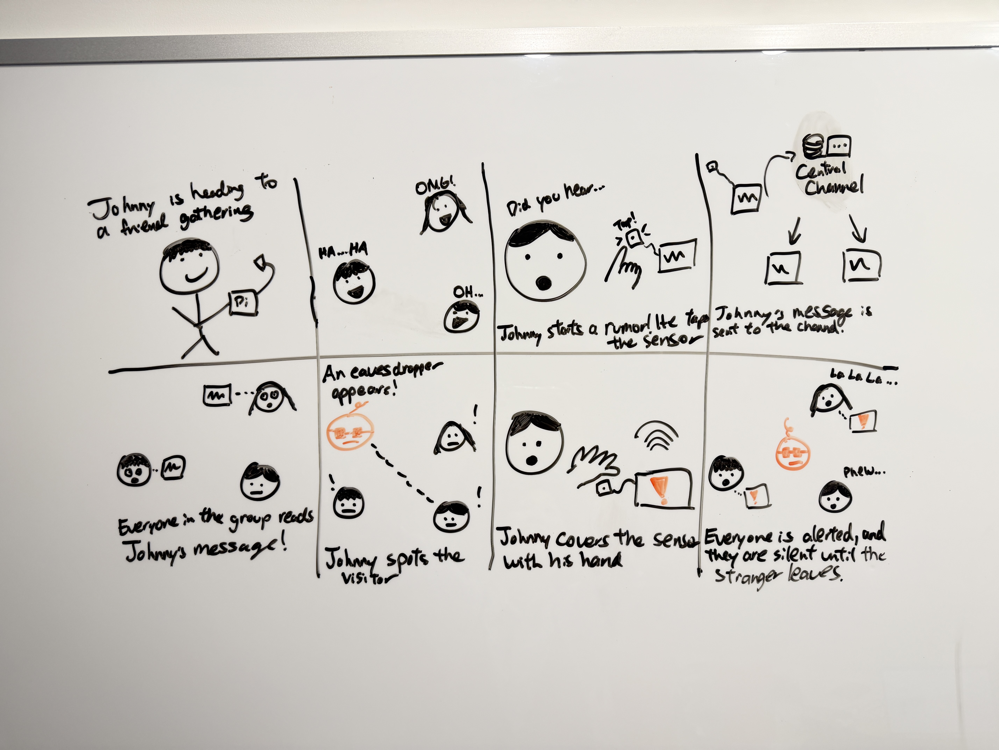

Johnny brings his Pi to a gathering with friends. He taps the sensor to start a rumor ("Did you hear..."). The message goes to a central channel (the MQTT broker), which passes it on to everyone else's Pi, so the whole group reads it. When an eavesdropper shows up, Johnny covers the sensor with his hand. Every Pi gets the alert, and the group stays quiet ("la la la...") until the stranger leaves.

**System architecture**

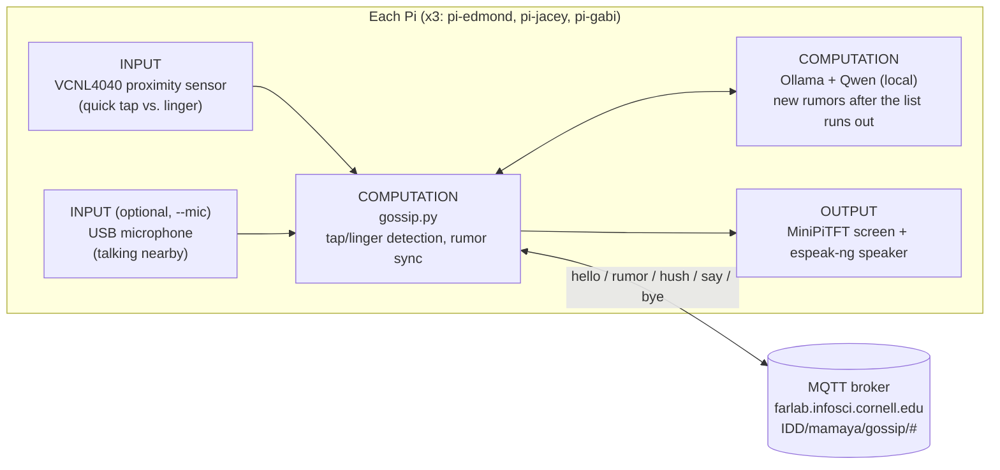

- **Input:** each Pi's VCNL4040 reads proximity. A quick tap (under 1.5 s) starts a rumor, and something staying close (1.5 s or more) counts as an eavesdropper. With `--mic`, talking near the Pi also starts a rumor.
- **Computation:** `gossip.py` runs on every Pi. It decides tap vs. linger, keeps track of which rumors each Pi knows, and sends missing rumors to the others. When the starter list runs out, the Pi asks its own local Qwen model for a new rumor.
- **Output:** each Pi shows the conversation on its screen and speaks it out loud if it has a speaker.
- **Network:** the Pis never talk to each other directly. Everything goes through the shared MQTT broker, so any Pi on campus Wi-Fi can join.

### Build Documentation

**The three Pis**

| pi-edmond | pi-jacey | pi-gabi |
|---|---|---|
| 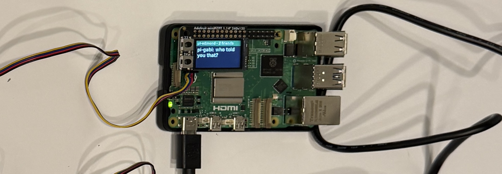 | 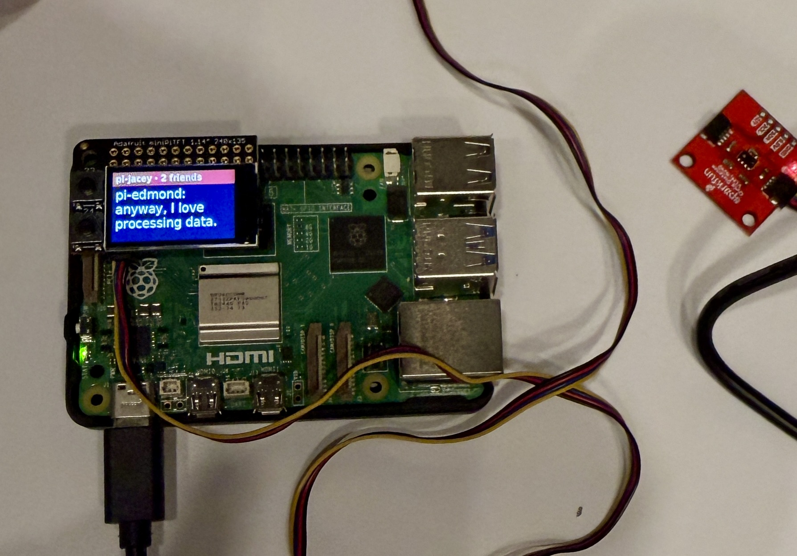 | 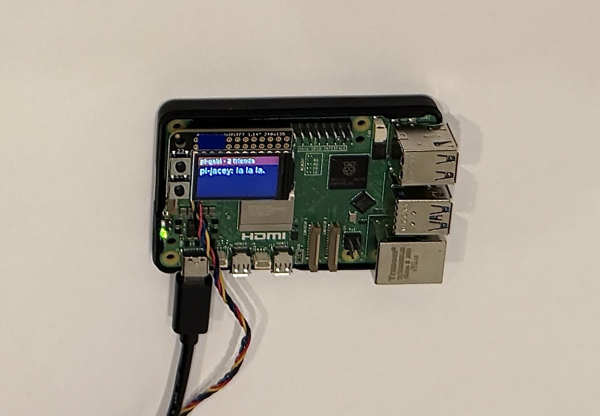 |

Each Pi has a VCNL4040 proximity sensor on the Qwiic port, the MiniPiTFT screen, and a speaker. The MQTT topics are listed in the table above.

**Tap vs. linger.** One sensor gives two inputs, depending on how long something stays close. A short visit starts a rumor, and a long one means someone is eavesdropping:

```python
if prox >= threshold:
    if close_since is None:
        close_since = now
    last_close = now
    if not self.someone_listening and now - close_since >= HUSH_AFTER:   # 1.5 s or more
        self.someone_listening = True
        self.say(random.choice(EAVESDROP_LINES))
        self.publish_hush()   # warn the other Pis right away
elif close_since is not None and now - last_close > LEFT_AFTER:
    held = last_close - close_since
    if not self.someone_listening and MIN_TAP <= held < HUSH_AFTER:   # quick tap
        self.start_rumor()
    close_since = None
```

**How rumors spread.** Every Pi publishes a `hello` every 2 seconds listing the rumor IDs it knows. When a Pi sees that a friend is missing one, it whispers a single rumor to that friend's own topic. Sending one rumor per hello makes the gossip trickle out like a real conversation, and a Pi that joins late gets caught up the same way.

```python
if kind == "hello" and who != self.id:
    ...
    if self.is_near(who) and not self.is_quiet():
        missing = [rid for rid in self.rumors if rid not in set(msg.get("known", []))]
        if missing:
            rid = random.choice(missing)   # one rumor per hello
            self.publish(f"rumor/{who}", json.dumps({"from": self.id, "rid": rid, **self.rumors[rid]}))
```

**What it looks like in practice.** This is part of the log from pi-jacey during a run with all three Pis. Rumors arrive with their source, and a second-hand rumor says who it came from. When Edmond's sensor spots an eavesdropper, all three Pis switch to small talk, and the rumors held back during the hush arrive once the coast is clear:

```
[22:07:20] pi-jacey: psst, pi-gabi just told me the projector pretends to be broken on Mondays
[22:07:29] pi-jacey: ooh, I just heard the thermostat and the window are not speaking anymore
[22:07:38] pi-jacey: psst, pi-edmond just told me the speaker has been practicing its singing at night
[22:07:55] pi-edmond: shh! someone's listening.
[22:07:55] pi-jacey: anyway, I love processing data.
[22:07:55] pi-gabi: so... nice weather today.
[22:08:20] pi-edmond: coast is clear.
[22:08:21] pi-jacey: psst, pi-gabi just told me the smart fridge has been reading everyone's grocery lists
[22:08:29] pi-jacey: psst, pi-gabi just told me someone saw the printer jam on purpose (they heard it from pi-edmond)
```

### User Testing

We tested Gossiping Pis with three people outside our team.

#### Tester 1: Irene

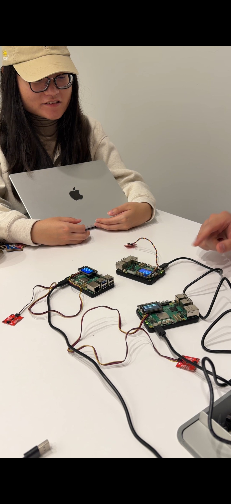

- **Before trying:** She expected the Pis to read her mind while she talked, picking up what she was thinking and how she felt, because it's sometimes hard to get a message across just by talking.
- **What surprised her:** The "stop gossiping" moment, when an eavesdropper makes the Pis go quiet. She asked how we came up with it, since in real life people who are gossiping don't know how to stop.
- **What she would change:** She found the interaction fun but asked what the point of it was, and suggested turning it into a board game.

#### Tester 2: Serena

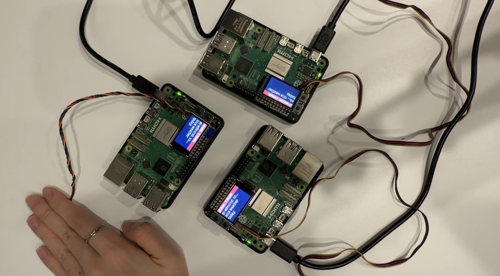

- **Before trying:** She was confused about how it worked. It wasn't clear how her message would be sent, so she ended up not saying anything.
- **What surprised her:** How fast the messages traveled between the Pis.
- **What she would change:** She wasn't sure this would work as a real interaction, because tapping the sensor to send a message felt unnatural.

#### Tester 3: Yuki

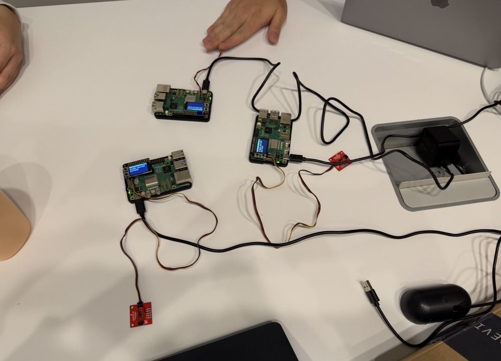

- **Before trying:** They had no idea how a message would get to the machines, and thought they would have to say something. It turned out only the machines talk.
- **What surprised them:** The devices really did gossip with each other, passing rumors along as quickly as people would. They found it interesting even just to watch.
- **What they would change:** The screen was too small to follow the conversation, and the messages scrolled by too fast.

#### What we learned from testing

Each tester pointed at a different part of the design:

- **Meaning (Irene):** the system is fun to watch, but it doesn't give people a goal. Adding scoring rules, like a spy player who tries to "catch" a rumor while it's spreading, could turn it into a game.
- **Trigger (Serena):** tapping a sensor doesn't match anything people do in daily life. Two testers also expected to speak to the Pis before trying, which suggests voice would feel like a more natural way to start a rumor. This led to our iteration below.
- **Display (Yuki):** every screen shows all three Pis' lines, and the idle reactions (`no way!`, `mm-hmm`) come up often, so the real rumors get lost. We could lower how often the idle reactions appear, rely more on the speaker, or show the full conversation on a laptop through the MQTT viewer.

### Iteration: Adding a Microphone

**Storyboard (second version)**

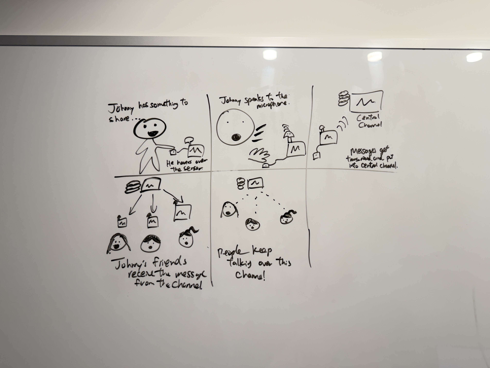

After user testing, we redrew the storyboard around voice. Johnny has something to share, so he hovers over the sensor and speaks into the microphone on his Pi. The message goes into the central channel, every friend's Pi receives it, and people keep talking over the channel.

**What we built**

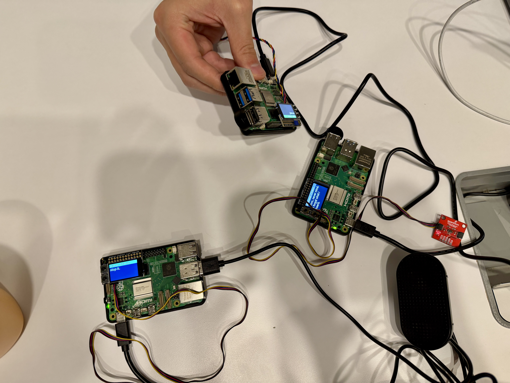

We added a USB microphone to the Pi and a `--mic` option to `gossip.py`. When people talk near a Pi, it "overhears" something and starts a new rumor, which then spreads to the other Pis as before. In this version the Pi only measures how loud the room is. It doesn't record or transcribe speech, so the rumor text still comes from our list or the local Qwen model. Turning the speech itself into the rumor, as the storyboard shows, is the next step.

```python
if loudness(data) >= self.mic_threshold:
    loud_times.append(now)
loud_times = [t for t in loud_times if now - t <= MIC_WINDOW]
if len(loud_times) * MIC_CHUNK >= MIC_TALK:   # about 0.6 s of talking within 2 s
    self.start_rumor()
```

Because all three Pis sit in the same room, their own voices could set each other off in an endless loop. To prevent that, the mic is ignored for 4 seconds after any Pi says something, and there are at least 10 seconds between mic-triggered rumors. The VCNL4040 still detects eavesdroppers, so leaning in still makes the whole group go quiet.

```bash
python gossip.py --mic-calibrate --mic-device plughw:2,0   # pick a threshold between quiet and talking
python gossip.py --name pi-jacey --mic --mic-device plughw:2,0 --mic-threshold <number> ...
```

### Reflection

**Reflection on the reading: The Presence Table**

The Presence Table connects two households through a table whose surface lights up with a trace of people's gestures and the everyday objects placed on it. That trace is sent over the network to a linked table in the other home, so each family gets an ambient sense that the other is there. Like our project, it is a set of devices on a network that react to what people do near them. The difference is where the person sits in the loop. On the Presence Table, people's own gestures are the content being shared. In Gossiping Pis, the Pis do all the talking and people mostly watch, except when they start a rumor or interrupt as an eavesdropper. The reading helped us see that gap, and it points to the direction we would take next: letting people's presence and voice become part of what gets passed around.

**What worked well**

The Pis respond very quickly. A rumor started on one Pi shows up on the others within seconds, and all three go quiet at almost the same moment when someone leans in. That speed is what makes the interaction feel like real gossip, as if three friends were whispering right in front of you. Testers noticed this too: Serena and Yuki were both surprised by how fast the messages traveled.

**Challenges with distributed interaction**

- Every sensor reads a little differently, so each Pi needs its own threshold. On pi-jacey, a hand had to be within about 3 cm before the reading rose above the noise.
- With three Pis talking in one room, there is a lot of output. Every screen shows all three Pis' lines, which made the small screen hard to follow (Yuki's feedback).
- Adding the microphone created a new problem: the Pis' own voices could trigger each other in a loop, so we had to ignore the mic right after any Pi speaks.

**How sensor events worked**

The VCNL4040 gives a single number, but timing turns it into two events: a quick tap (under 1.5 s) starts a rumor, and staying close (1.5 s or more) is an eavesdropper. The microphone adds a third event: about 0.6 s of talking within 2 s starts a rumor.

**What we would improve**

Right now the person is mostly a spectator. The Pis gossip with each other, and people only start or interrupt the conversation. We would like the person to take part more. For example, transcribing what someone says so their own words become the rumor (as our second storyboard shows), or adding game rules where a "spy" player tries to catch a rumor while it spreads, as Irene suggested. We would also move the full conversation to the speaker or a larger display and keep the small screen for showing each Pi's mood.

**Where computation happens, and why**

All of the logic runs on each Pi in `gossip.py`: reading the sensor, deciding tap vs. linger, tracking which rumors each Pi knows, and drawing the screen. The MQTT broker only relays messages, so any Pi on campus Wi-Fi can join, and no Pi is in charge. The language model (Qwen through Ollama) also runs locally on each Pi, but only when the starter rumor list runs out, not on every sensor event. Generating a rumor takes several seconds on a Pi, so calling it on every tap would make the interaction feel slow. Using the written list first keeps the common case fast.